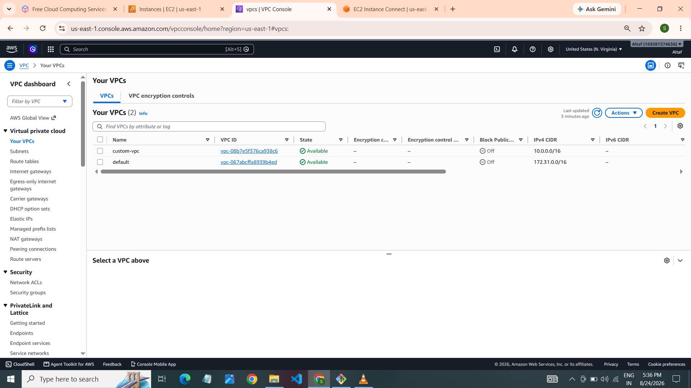
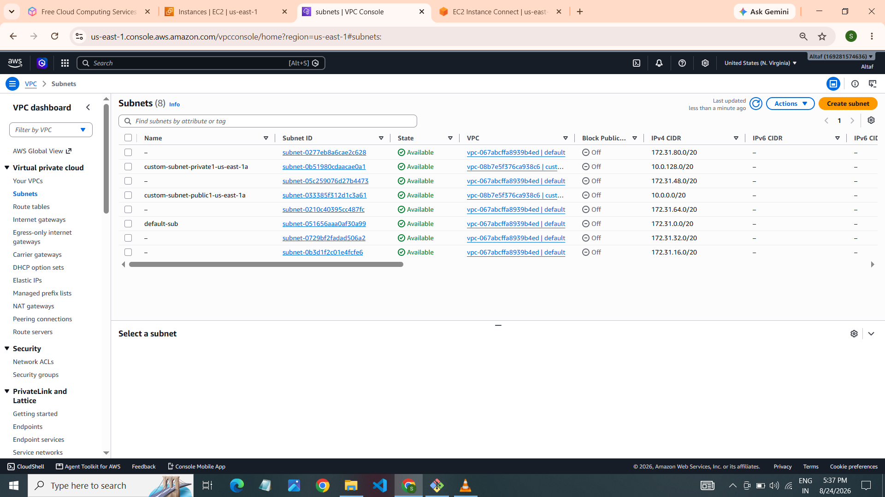
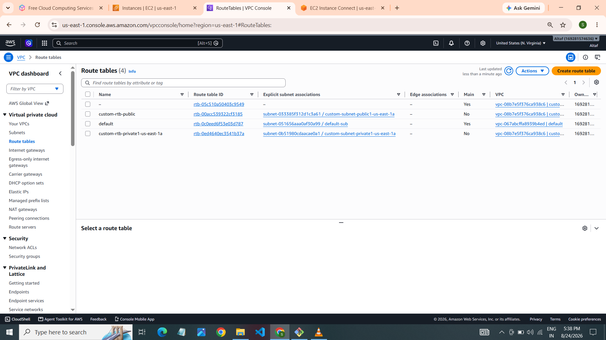
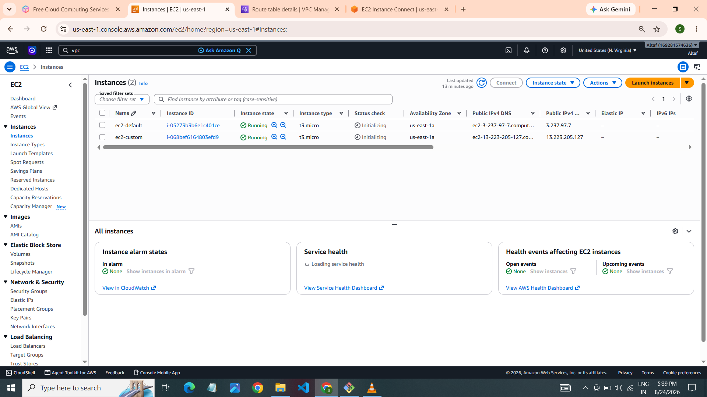

# ☁️ AWS Task 4 – VPC & EC2 Infrastructure Setup

<p align="center">
  
  
  
  
</p>

## 📌 Project Overview

This project demonstrates AWS networking and compute infrastructure setup using Amazon VPC, Subnets, Route Tables, EC2 Instances, and Security Groups.

The objective is to understand how AWS resources communicate within a VPC and how network traffic is controlled.

## 🛠️ AWS Services Used

| Service | Purpose |
|---|---|
| Amazon VPC | Create an isolated network |
| Subnets | Divide the VPC network |
| Route Tables | Control network traffic |
| Internet Gateway | Provide internet connectivity |
| NAT Gateway | Enable private subnet outbound internet access |
| Amazon EC2 | Launch virtual servers |
| Security Groups | Control inbound and outbound traffic |

## 🏗️ Architecture Overview

```text
                 AWS Cloud
                     |
                    VPC
                     |
          +----------+----------+
          |                     |
      Public Subnets        Private Subnets
          |                     |
     Internet Gateway       NAT Gateway
          |                     |
       EC2 Instance         EC2 Instance
          |                     |
     Security Group       Security Group
```

## 🚀 Implementation Steps

<details>
<summary><b>1️⃣ Create VPC</b></summary>

- Create a custom VPC.
- Configure the IPv4 CIDR block.
- Verify the VPC configuration.

📸 Screenshot:



</details>

<details>
<summary><b>2️⃣ Create Subnets</b></summary>

- Create six subnets.
- Configure subnet CIDR blocks.
- Associate subnets with the VPC.

📸 Screenshot:



</details>

<details>
<summary><b>3️⃣ Configure Route Tables</b></summary>

- Create public and private route tables.
- Configure routes.
- Associate the appropriate subnets.

📸 Screenshot:



</details>

<details>
<summary><b>4️⃣ Launch EC2 Instances</b></summary>

- Launch two EC2 instances.
- Select the appropriate VPC and subnets.
- Configure security groups.
- Verify instance status.

📸 Screenshot:



</details>

<details>
<summary><b>5️⃣ Configure Security Groups</b></summary>

- Configure inbound rules.
- Configure outbound rules.
- Allow only required network traffic.

📸 Screenshot:


</details>

## 📷 Project Screenshots

| Resource | Screenshot |
|---|---|
| VPC | `01-vpc.png` |
| Subnets | `02-subnets.png` |
| Route Tables | `03-route-tables.png` |
| EC2 Instances | `04-ec2-instances.png` |
| Security Groups | `05-security-groups.png` |

## 🎯 Learning Outcomes

- Understanding AWS VPC networking.
- Creating and managing subnets.
- Configuring route tables.
- Understanding Internet Gateway and NAT Gateway.
- Launching EC2 instances.
- Configuring Security Groups.

## 👨‍💻 Author

**Shaikh Altaf**

Cloud Computing | AWS | Terraform | Linux

---

<p align="center">
  ⭐ If you find this project useful, consider giving it a star!
  <br/>
  <b>Learning AWS through hands-on projects 🚀</b>
</p>